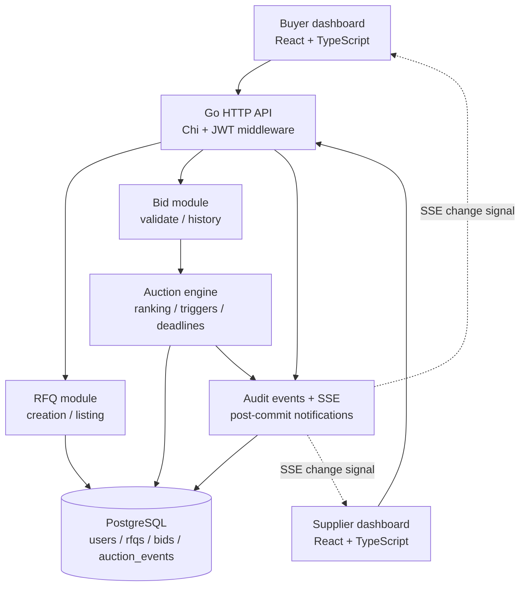

# 02 — HLD, LLD and service boundaries

## HLD — simple architecture diagram (submission-ready)



### Deployment topology

- Browser visits a Vite/React frontend. During local development, Vite proxies `/api` to the Go backend. In a simple packaged release, a reverse proxy can serve frontend and proxy API.
- One Go process owns HTTP handlers, services, auction logic, SSE subscribers, and pgxpool. Multiple replicas are **not** necessary or supported for guaranteed in-memory SSE fan-out in MVP.
- One PostgreSQL database is the transactional source of truth. Docker Compose starts frontend, backend, DB. No broker, Redis, WebSocket service, or scheduler.

## LLD — Go package boundaries (target, not code yet)

```text
backend/
  cmd/server/main.go                 # composition root, config, HTTP server
  internal/
    config/                         # env config, validation
    domain/                         # RFQ, bid, rankings, event types, rules
    auction/                        # pure rankings / trigger / time rules
    auth/                           # JWT/password hash and identity
    service/                        # use cases, transactional orchestration
    repository/postgres/            # pgx SQL and transaction repositories
    httpapi/                        # routes, handlers, middleware, DTOs
    realtime/                       # simple in-process SSE broadcaster
  migrations/                       # versioned up/down SQL
  tests/integration/                # real Postgres tests, isolated fixtures
frontend/
  src/
    app/                             # router + providers
    api/                             # typed fetch and auth token handling
    features/auth/
    features/rfqs/
    features/bidding/
    features/events/
    components/                      # reusable view controls
    utils/                           # money & date formatting helpers
  ...
compose.yaml
.env.example
```

Allow idiomatic minor path adjustments during implementation, but avoid adopting a framework that obscures transaction boundaries.

## Domain responsibilities

| Layer | It owns | It must not own |
|---|---|---|
| `httpapi` | decode/validate HTTP shape; auth middleware; status and error mapping | rank calculation or SQL strings |
| `auth` | JWT generation/validation; password hash; roles | business bid ordering |
| `service` | RFQ create/list; submit-bid transaction orchestration | HTTP response serialization |
| `auction` | pure ranking, change detection, extension decision, state evaluation | network, DB connections, global clock |
| `repository/postgres` | SQL persistence; row lock; clock within transaction; pagination | pricing policy or frontend messages |
| `realtime` | signal clients *after* committed changes | decide accepted bids; durable state |
| React features | views, forms, timers, optimistic disabled controls, refetch | authoritative deadline and rank acceptance |

## Logical use cases

### Create RFQ

1. Authenticate buyer; validate reference/name, service date, times, currency, X/Y/trigger.
2. Insert RFQ (`current_close_at = initial_close_at`) and `RFQ_CREATED` audit event in **one transaction**.
3. Return created RFQ + derived status.

### Submit bid

1. Authenticate supplier and validate request syntax plus UUID idempotency key.
2. Start PostgreSQL transaction and lock the target RFQ row (`FOR UPDATE`).
3. Check a prior bid exists for same RFQ/supplier/idempotency key — if yes, return original outcome without mutation.
4. Ask the DB for `clock_timestamp()` **after** lock acquisition; enforce active interval and quote rules.
5. Read latest per supplier and current ranking, enforce own-price improvement.
6. Insert immutable bid and `BID_ACCEPTED` event; recalculate ranking.
7. If inside X window and selected trigger satisfied, extend capped at forced close; record `AUCTION_EXTENDED` with old/new close and reason.
8. Commit once. Signal SSE subscribers after successful commit. Respond with bid, current close, current rank, whether extension happened.

### List/detail and status

- Use a stable DB-generated read timestamp for status in each request; current lowest bid is minimum of latest accepted bid per supplier.
- Listing pages paginate; detail includes full configuration, current rank snapshot, **all accepted bids sorted by total price by default**, and events as separate paginated calls.
- UI countdown uses server-time offset for display only; backend remains authoritative.

## Sequence diagram — one accepted bid

```mermaid
sequenceDiagram
    participant UI as Supplier UI
    participant HTTP as Go HTTP API
    participant SVC as Bid Service
    participant DB as PostgreSQL
    participant SSE as SSE broadcaster
    UI->>HTTP: POST /rfqs/:id/bids + Idempotency-Key
    HTTP->>SVC: SubmitBid(supplier, quote, key)
    SVC->>DB: BEGIN; SELECT RFQ FOR UPDATE
    DB-->>SVC: locked RFQ
    SVC->>DB: check idempotency; SELECT clock_timestamp()
    SVC->>DB: query latest quotes / current rank
    SVC->>DB: INSERT bid and BID_ACCEPTED event
    SVC->>SVC: pure rank comparison and trigger evaluation
    opt valid trigger inside X window
      SVC->>DB: UPDATE current_close_at; INSERT AUCTION_EXTENDED
    end
    SVC->>DB: COMMIT
    SVC->>SSE: broadcast rfq_changed (best effort)
    SVC-->>HTTP: accepted outcome
    HTTP-->>UI: 201 Created
    SSE-->>UI: rfq_changed
    UI->>HTTP: GET latest canonical ranking/details
```

## Design rationale and limits

- **Monolith over microservices:** domain is cohesive; transactional row lock in one DB handles concurrency without cross-service distributed transactions.
- **PostgreSQL over Redis-managed auction clocks:** deadline behavior does not depend on ephemeral state; DB row-lock serialization is straightforward.
- **SSE over WebSockets:** only server-to-client update signals are needed; write operations remain HTTP. SSE can drop signals; clients refetch to correct state.
- **Status derived rather than background updates:** exact close behavior holds even if no process is running at the closing instant. Do not promise real-time `CLOSED` events without a worker.
- **Data access:** hand-written parameterized SQL is easier to review for lock scope and rank queries than opaque ORM transactions.
- **Expected scale:** typical demo RFQs with tens/hundreds of suppliers. Optimize correctness first; add indexes and pagination, no premature cache.

## Security basics

- JWT bearer auth on `/api` routes other than login and health. Verify algorithm, signature, expiry and user role. Sign with environment-provided secret; do not log tokens.
- UI stores token in memory only; request `Authorization: Bearer ...`. For SSE use fetch-based streaming with the same header, **not** native EventSource relying on an impossible custom header.
- Password hashes only; enforce buyer/supplier permissions server side; CORS restricted to development origin if applicable; parameterized SQL, input length limits and HTTP timeouts.
- Environment names: `DATABASE_URL`, `DATABASE_TEST_URL`, `JWT_SECRET`, `APP_PORT`, `FRONTEND_ORIGIN` and local PostgreSQL credentials. Keep values consistent across `.env.example` and Compose without committing live secrets.
- TLS/hosting is optional and not in the assignment; no deployment without user authorization.
