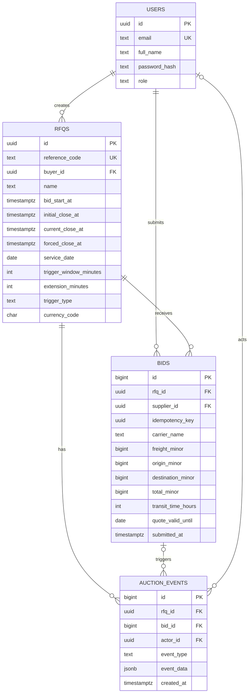

# 03 — PostgreSQL schema and data-access design

**This is the approved DDL specification**, not yet an applied migration. Implement it as executable versioned migration files using PostgreSQL 16+.

## ER diagram



## Proposed PostgreSQL DDL (to translate into numbered migration)

```sql
CREATE TABLE users (
    id UUID PRIMARY KEY DEFAULT gen_random_uuid(),
    full_name TEXT NOT NULL CHECK (length(trim(full_name)) > 0),
    email TEXT NOT NULL,
    password_hash TEXT NOT NULL,
    role TEXT NOT NULL CHECK (role IN ('BUYER', 'SUPPLIER')),
    created_at TIMESTAMPTZ NOT NULL DEFAULT now()
);
CREATE UNIQUE INDEX users_email_lower_uq ON users (lower(email));

CREATE TABLE rfqs (
    id UUID PRIMARY KEY DEFAULT gen_random_uuid(),
    reference_code TEXT NOT NULL UNIQUE,
    name TEXT NOT NULL,
    buyer_id UUID NOT NULL REFERENCES users(id),
    currency_code CHAR(3) NOT NULL DEFAULT 'INR',
    service_date DATE NOT NULL,
    bid_start_at TIMESTAMPTZ NOT NULL,
    initial_close_at TIMESTAMPTZ NOT NULL,
    current_close_at TIMESTAMPTZ NOT NULL,
    forced_close_at TIMESTAMPTZ NOT NULL,
    trigger_window_minutes INTEGER NOT NULL CHECK (trigger_window_minutes > 0),
    extension_minutes INTEGER NOT NULL CHECK (extension_minutes > 0),
    trigger_type TEXT NOT NULL CHECK (
      trigger_type IN ('ANY_BID', 'ANY_RANK_CHANGE', 'L1_CHANGE')
    ),
    created_at TIMESTAMPTZ NOT NULL DEFAULT now(),
    updated_at TIMESTAMPTZ NOT NULL DEFAULT now(),
    CONSTRAINT rfq_nonempty_name CHECK (length(trim(name)) > 0),
    CONSTRAINT rfq_nonempty_reference CHECK (length(trim(reference_code)) > 0),
    CONSTRAINT rfq_initial_times CHECK (bid_start_at < initial_close_at),
    CONSTRAINT rfq_force_after_initial CHECK (initial_close_at < forced_close_at),
    CONSTRAINT rfq_current_bounded CHECK (
       current_close_at >= initial_close_at
       AND current_close_at <= forced_close_at
    )
);

CREATE TABLE bids (
    id BIGINT GENERATED ALWAYS AS IDENTITY PRIMARY KEY,
    rfq_id UUID NOT NULL REFERENCES rfqs(id),
    supplier_id UUID NOT NULL REFERENCES users(id),
    idempotency_key UUID NOT NULL,
    carrier_name TEXT NOT NULL CHECK (length(trim(carrier_name)) > 0),
    freight_minor BIGINT NOT NULL CHECK (freight_minor >= 0),
    origin_minor BIGINT NOT NULL CHECK (origin_minor >= 0),
    destination_minor BIGINT NOT NULL CHECK (destination_minor >= 0),
    total_minor BIGINT GENERATED ALWAYS AS
        (freight_minor + origin_minor + destination_minor) STORED,
    transit_time_hours INTEGER NOT NULL CHECK (transit_time_hours > 0),
    quote_valid_until DATE NOT NULL,
    submitted_at TIMESTAMPTZ NOT NULL,
    UNIQUE (rfq_id, supplier_id, idempotency_key),
    CONSTRAINT positive_bid_total CHECK (total_minor > 0)
);

CREATE TABLE auction_events (
    id BIGINT GENERATED ALWAYS AS IDENTITY PRIMARY KEY,
    rfq_id UUID NOT NULL REFERENCES rfqs(id),
    bid_id BIGINT NULL REFERENCES bids(id),
    actor_id UUID NULL REFERENCES users(id),
    event_type TEXT NOT NULL CHECK (
       event_type IN ('RFQ_CREATED', 'BID_ACCEPTED', 'AUCTION_EXTENDED')
    ),
    event_data JSONB NOT NULL DEFAULT '{}'::jsonb,
    created_at TIMESTAMPTZ NOT NULL
);

CREATE INDEX rfqs_buyer_created_idx ON rfqs (buyer_id, created_at DESC);
CREATE INDEX rfqs_created_idx ON rfqs (created_at DESC, id);
CREATE INDEX bids_rfq_supplier_latest_idx
    ON bids (rfq_id, supplier_id, submitted_at DESC, id DESC);
CREATE INDEX bids_rfq_chronological_idx
    ON bids (rfq_id, submitted_at DESC, id DESC);
CREATE INDEX bids_rfq_price_idx
    ON bids (rfq_id, total_minor ASC, submitted_at ASC, id ASC);
CREATE INDEX events_rfq_history_idx
    ON auction_events (rfq_id, created_at DESC, id DESC);
```

### Schema notes

- `bids` is append-only at the application layer; no update/delete endpoints. If DB write roles can be separated, consider SQL privileges that disallow update/delete outside migrations. No trigger is required for MVP.
- Use UUID identifiers for public users/RFQs; use BIGINT identity for ordered historical rows. `idempotency_key` is UUID and unique **per (RFQ, supplier)**.
- `total_minor` is generated by DB to avoid mismatch with component charges. Backend independently checks nonnegative and overflows before insert; PostgreSQL BIGINT overflow will also reject impossible sums. DB check total > 0.
- `event_data` holds structured immutable event-specific fields. Example extension: `{ "trigger_type":"L1_CHANGE", "reason":"L1 supplier changed", "old_close_at":"...", "new_close_at":"...", "old_l1_supplier_id":"...", "new_l1_supplier_id":"..." }`. Store all timestamp values with ISO offsets/Z.
- Authentication role checks and quote valid-until vs service-date checks are **cross-table/domain checks** enforced in service logic, not ordinary SQL CHECK constraints.
- Migrations should implement up/down paths (or explicitly document irreversible changes) and a local development **seed script/command** for one buyer plus three suppliers. Seed is idempotent; never put real passwords in tracked production configuration.
- All timestamps use `TIMESTAMPTZ`. The DB timezone should be UTC for consistency, but PostgreSQL stores instants independently of the session timezone.

## Current ranking query (conceptual)

```sql
WITH latest AS (
  SELECT DISTINCT ON (supplier_id)
      id, rfq_id, supplier_id, carrier_name,
      freight_minor, origin_minor, destination_minor, total_minor,
      transit_time_hours, quote_valid_until, submitted_at
  FROM bids
  WHERE rfq_id = $1
  ORDER BY supplier_id, submitted_at DESC, id DESC
)
SELECT *
FROM latest
ORDER BY total_minor ASC, submitted_at ASC, supplier_id ASC;
```

- Read only accepted bids (all rows in `bids` represent accepted bids).
- Ranking is **dense sequential positions** L1, L2, L3, not SQL `RANK()` leaving gaps after ties. No two suppliers occupy the same position.
- Compare pre- and post-bid arrays of supplier IDs to detect `ANY_RANK_CHANGE`. Compare first supplier ID for `L1_CHANGE` only if previous rank array is non-empty.
- `updated_at` of RFQ is explicitly set when current close changes (or initial creation), never used as a deadline.

## Transaction and locking

- `READ COMMITTED` is sufficient for serialized writes per RFQ because **every** bid write acquires `SELECT ... FROM rfqs WHERE id = $1 FOR UPDATE` and holds the lock until committed.
- Enforce fixed lock acquisition order: RFQ first, then read bids, then write bid/events. Do not introduce another code path that writes bids without this lock.
- Read DB `clock_timestamp()` only **after** acquiring lock to classify a bid against the real acceptance time, especially when a request was queued waiting for a lock.
- On idempotent replay, check the stored key under RFQ lock before deadline checking; replay must not repeat side effects.
- Keep transaction short and do not perform network/SSE calls before COMMIT. If COMMIT fails, respond with an error and emit nothing.

## Important deliberate limitation

PostgreSQL row locks serialize bidding within a single database even if the backend scales out. **The SSE broadcaster is in-process**, so a multi-replica deployment would need a shared notification mechanism or polling; MVP supports one replica, with reconnect/refetch providing a correctness fallback.
